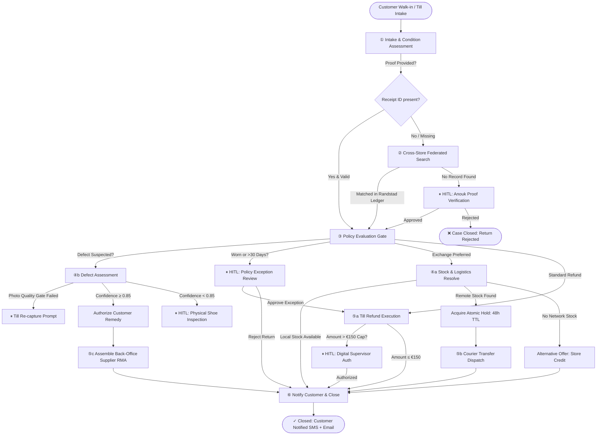

# 👟 Sallie's Shoes — Omnichannel AI Returns & Exchange Agent Pipeline

[](https://knarayanareddy.github.io/sallie-returns-ai-agent/)
[](https://www.python.org/)
[](LICENSE)
[](#system-architecture)
[](#enterprise-guardrails--hitl-governance)

> **Enterprise-grade Autonomous Returns & Exchanges Orchestrator** designed for multi-store retail. Features a deterministic 6-node state machine, federated cross-store receipt lookup, atomic inventory holds (48h TTL), structural defect classification with photo quality gates, parallel supplier RMA claim assembly, and interactive Human-in-the-Loop (HITL) supervisor triage.

---

### 🌐 Live Interactive Demo
Try the full interactive dashboard and live operator chatbot directly in your browser without installing anything:
👉 **[Launch Live Demo on GitHub Pages](https://knarayanareddy.github.io/sallie-returns-ai-agent/)**

- **Interactive Case Builder**: Run custom returns or test predefined scenarios.
- **Node-by-Node Visualizer**: Watch cases transition through intake, policy, stock resolution, and dispatch.
- **Supervisor HITL Queue**: Act as store manager Anouk or purchasing lead Robin to approve/reject exceptions.
- **Live Operator Chatbot**: Ask questions, query cross-store stock (`which stores have stock of SS-0087`), or inspect case audit trails (`show case V1`).
- **Interactive Architecture Blueprints**:
  - [📊 Version A Workflow Diagram](https://knarayanareddy.github.io/sallie-returns-ai-agent/version_a_workflow.html) — Single Orchestrator Architecture
  - [📐 Version B Architecture Diagram](https://knarayanareddy.github.io/sallie-returns-ai-agent/version_b_workflow.html) — Event-Driven Choreography

---

## 📌 Business Context & Problem Statement

*Sallie se Schoenen* operates 4 physical stores across the Dutch Randstad (**Utrecht, Rotterdam, Amsterdam, Haarlem**) plus an **E-commerce channel** and a **Central Warehouse**.

In omnichannel footwear retail, customer returns create severe operational bottlenecks:
1. **Missing Receipts**: Customers frequently return items bought at different branches without a receipt slip.
2. **Double-Selling during Transfers**: Requesting an exchange size from a remote store risks that pair being sold to a walk-in customer before courier dispatch.
3. **Subjective Defect Assessment**: Frontline store associates struggle to differentiate between genuine manufacturing faults (delamination, stitching failure) and wear-and-tear.
4. **Uncontrolled Refund Authority**: Unrestricted staff refunds lead to margin leakage and policy abuse.

This pipeline automates 80%+ of standard returns while seamlessly pausing for digital supervisor authorization whenever high-risk guardrails are triggered.

---

## 🏗️ System Architecture

The pipeline is modeled as a deterministic, single-orchestrator state machine operating over an immutable, shared `ReturnCaseState`.



---

## 🛡️ Enterprise Guardrails & HITL Governance

| Guardrail | Automated Threshold | Fallback / HITL Escalation |
| :--- | :--- | :--- |
| **Return Window** | Purchased within $\le 30$ days | Escalates to store supervisor (Anouk) for policy waiver |
| **Wear & Tear Gate** | Unworn (`is_worn=False`), packaging intact | Worn change-of-mind returns rejected per policy |
| **Refund Cap** | $\le €150.00$ auto-authorized at till | $> €150.00$ requires supervisor digital authorization |
| **Photo Quality Gate** | $\ge 3$ clear multi-angle images | $< 3$ images triggers automatic till re-capture loop |
| **Defect Confidence** | Multimodal CV confidence $\ge 0.85$ | $< 0.85$ pauses for physical supervisor shoe inspection |
| **Inventory Hold Lock** | Atomic decrement with 48h TTL lock | Prevents double-selling; auto-releases upon hold expiration |
| **Customer Notification** | Case cannot close without proof of notification | Terminal node verifies SMS/Email delivery or till-slip print |

---

## 🧪 Validated Test Scenarios

The codebase includes 5 end-to-end regression test cases (available in `returns_pipeline/version_a/demo.py` and in the web demo):

| Case | Scenario | Key Guardrail Tested | Pipeline Outcome |
| :--- | :--- | :--- | :--- |
| **V1** | **Standard In-Policy Refund** | Receipt verified (`REC-883921`), unworn, under €150 cap | Auto-refund €89.95 executed, SMS/Email sent, case closed |
| **V2** | **Cross-Store Exchange** | Missing receipt; federated search locates Amsterdam purchase | Exchange size held at Rotterdam (3 units), courier transfer dispatched, collection date estimated |
| **V3** | **Unmatched Transaction** | Missing receipt; customer record not found in Randstad ledger | Pauses at `cross_store_lookup` HITL queue. Supervisor manually approves/rejects |
| **V4** | **Manufacturing Defect** | Known defective batch (`SS-0091`) sole delamination | CV confidence 0.91 triggers defect remedy precedence; back-office supplier RMA assembled in parallel |
| **V5** | **Worn Goods Policy Violation** | Receipt verified (`REC-000555`, 35 days old), shoe clearly worn | Policy check flags violation $\rightarrow$ HITL pause $\rightarrow$ supervisor rejection issued |

---

## 💻 Local Setup & Execution

### Prerequisites
- Python 3.9+
- pip

### 1. Clone & Setup
```bash
git clone https://github.com/knarayanareddy/sallie-returns-ai-agent.git
cd sallie-returns-ai-agent
python3 -m venv .venv
source .venv/bin/activate
pip install -r requirements.txt
```

### 2. Run the End-to-End CLI Demo Runner
Executes all 5 production scenarios with full step-by-step state mutation audit logs:
```bash
python3 -m returns_pipeline.version_a.demo
```

### 3. Run the Interactive Web Application
Launches the full interactive preview with the case builder, node visualizer, supervisor triage dashboard, and floating chatbot:
```bash
python3 -m returns_pipeline.version_a.app
```
Open **[http://localhost:8765](http://localhost:8765)** in your browser.

---

## 📂 Repository Structure

```
.
├── index.html                   # 100% In-browser standalone demo for GitHub Pages
├── version_a_workflow.html      # Interactive Single-Orchestrator Architecture Blueprint
├── version_b_workflow.html      # Interactive Event-Driven Choreography Architecture
├── requirements.txt             # Python dependencies (Flask, Pydantic)
├── returns_pipeline/
│   └── version_a/
│       ├── __init__.py
│       ├── app.py               # Flask interactive web server & REST endpoints
│       ├── orchestrator.py      # Core 6-node state machine orchestrator
│       ├── state_models.py      # Pydantic state schema, enums & immutable case models
│       ├── tools.py             # Mock inventory locks, CV classifier, ledger lookups
│       └── demo.py              # CLI test runner executing Cases 1 through 5
├── LICENSE                      # MIT License
└── README.md                    # Systems documentation & architecture manual
```

---

## 📄 License
This project is open-sourced under the [MIT License](LICENSE).
EOF